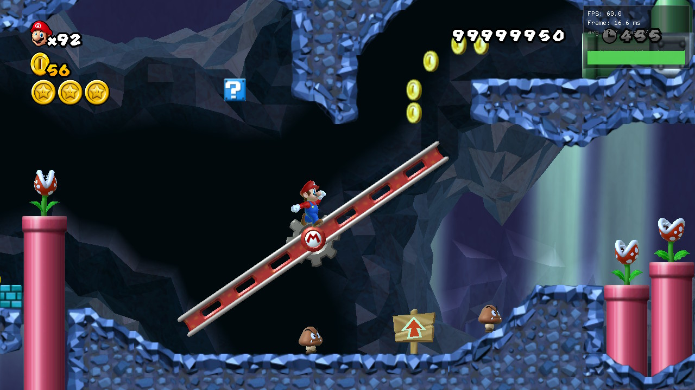
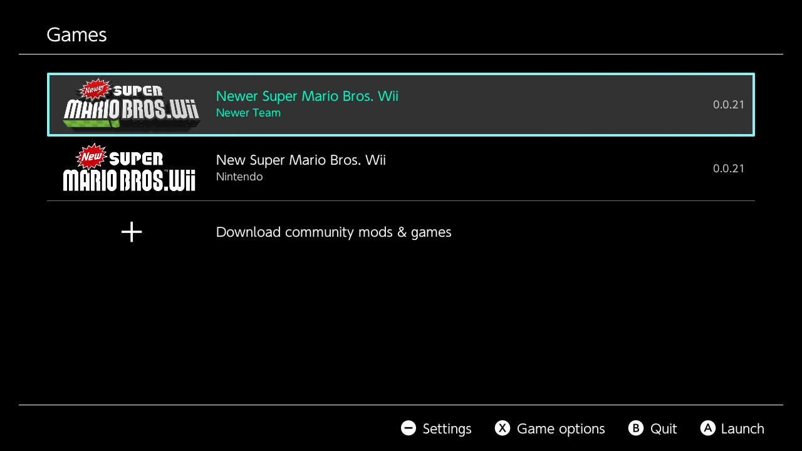

# New Super Mario Bros. Wii for Nintendo Switch (Recomp)

  
  
  

A native port of New Super Mario Bros. Wii for the Nintendo Switch made with
static recompilation. 
This version has been specifically optimized for the Nintendo Switch and runs well at stock CPU clock speed, though a moderate overclock is recommended for stable 60fps in heavier levels.

Newer Super Mario Bros. Wii is supported too. It installs from the launcher and shares the base disc.

> [!NOTE]
> **This port is directly based on [WitherBlitz](https://github.com/WitherBlitz)'s NSMBW recomp for PC and Android: https://github.com/WitherBlitz/NSMB-Wii-Recompilation**
>
> Consider checking out the upstream repository for more information and give it a star!

> [!IMPORTANT]
> There are no Nintendo game files in this project or its releases: no disc image, no Nintendo
> levels, music, graphics or sounds. You need your own copy of **New Super Mario Bros. Wii (USA,
> `SMNE01`, revision 1)** (`.iso`, `.ciso`, `.wbfs`, `.wia`, `.rvz`) in `/switch/nsmbw/`, next to
> `launcher.nro`. The optional Newer pack contains community-made assets from the Newer Team, not
> Nintendo files.

**[I just want to play](#quick-start)**

  
   Running natively on Nintendo Switch.

---

## Contents

- [Features](#features)
- [Requirements](#requirements)
- [Quick start](#quick-start)
- [Launcher](#launcher)
- [Performance and overclocking](#performance-and-overclocking)
- [Building from source](#building-from-source)
- [AI usage](#ai-usage)
- [Credits and thanks](#credits-and-thanks)
- [License](#license)

---

## Features

* Launcher with the game catalogue, downloads, per-game updates and Update all
* Newer Super Mario Bros. Wii installed from the launcher, sharing the base disc
* Display styles: Detail, Banner Grid and Detail Grid
* Per-game home menu icons and launcher banners
* Version-only update detection with **Update available** chips
* Shader cache preload, with a toggleable Shader Status overlay
* HD texture pack support (downloadable in-game)
* Custom render resolutions: 0.5x to 4x the Wii's 480 lines (240p to 1920p)
* Touch screen support in menus and on the world map
* Battery saver: render at 30fps instead of 60fps
* Frame interpolation: Off, 60, 120, and more FPS; can be combined with battery saver
* Performance monitor: FPS counter and a frametime graph
* Gameplay changes/options:
  * Allows picking your character in single player
  * Auto-save after every level
  * 'Exit Course' from the pause menu in courses you haven't cleared yet (not the map's ambush fights)
  * No Time Limit (also hides the timer)
  * Infinite Lives cheat
  * Power-Up cheat

## Requirements

- A Nintendo Switch with homebrew support (Atmosphere and hbmenu).
- An SD card with enough free space for the disc extraction and game data.
- Your own **USA `SMNE01` revision 1** copy of New Super Mario Bros. Wii.
- Network access for the catalogue, Newer and updates.

Only the USA disc, revision 1 works currently. Other regions and revisions put the game's code at other
addresses, so the app checks the disc and refuses anything else. Newer does not need a Newer disc: the
launcher downloads its pack and uses the base game's disc.

> [!NOTE]
> Dumping your own disc is your responsibility, and links to
> game files won't be provided or tolerated.
>
> To dump your own disc, you need a Wii and the correct NSMBW disc. Then follow these instructions: https://wii.hacks.guide/dump-games

## Quick start

Get the ZIP file from the [Releases](https://github.com/timschneeb/nsmbw-nx/releases/latest)
page.

> [!NOTE]
> Accepted Wii disc image formats: `.iso`, `.ciso`, `.wbfs`, `.wia`, `.rvz`

1. Download the Switch ZIP from the [Releases](https://github.com/timschneeb/nsmbw-nx/releases/latest) page.
2. Copy the ZIP contents onto the SD card of your Switch.
   * This creates a new folder at `/switch/nsmbw/`.
3. Copy your disc image into `/switch/nsmbw/`, next to `launcher.nro`. The launcher extracts the
   base game to `/switch/nsmbw/discs/SMNE01/` on first start.
4. Open 'NSMBW Launcher' in the hbmenu.
5. Optional: Open the `Download community mods & games` row to fetch the catalogue and install mods
   such as Newer. Press Minus to open Settings for Update all and Check launcher update. Newer reuses
   `discs/SMNE01` and keeps its data in `games/newersmbw/data/`. [Mods can also be manually installed.](https://github.com/timschneeb/nsmbw-nx-modules/#manual-installation)
6. Consider overclocking if you're planning to increase resolution or using the HD texture pack. See [Performance and overclocking](#performance-and-overclocking). The NewerSMBW mod has performance issues in some later levels, so a high overclock and FPS limit is needed in some parts. This will be fixed in the future.

> [!NOTE]
> The first boot will take about 5-10 minutes. It will extract the disc image and compile shaders for the first time.
> Subsequent boots will preload shaders in the background (~1-2 minutes) while the game is running. This may slightly impact performance during this time.
>
> The game crashed or shows something wrong? Open an issue with your device, what you did, and the log from `/switch/nsmbw/games/vanilla/data/Logs`.

## Launcher

  
   The launcher with installed games and version numbers

`/switch/nsmbw/launcher.nro` is the entry point. It lists installed games under
`/switch/nsmbw/games/`, downloads the catalogue, installs Newer, checks for updates and chainloads
the selected game. The games are separate NROs, which allows you to create direct forwarders for them using an app like Sphaira.

## Performance and overclocking

> [!NOTE]
> TL;DR: **CPU overclock of 1581MHz is recommended for guaranteed 60fps** at 1x resolution. Higher resolutions will also run well but may need further CPU/GPU overclocking.
> 
> **If you don't want to overclock, you can always enable 'Battery saver' to render at 30fps.** It greatly improves performance and even runs 1.5x resolution (HD) at stable 30fps at stock CPU clock speeds.

At stock CPU clock speed (1020MHz) the game will mostly perform around 60fps at 1x resolution (480p). In more complex levels, such as water/lava levels, the frame rate drops to around 45fps.
Note that the game logic is fixed at 60Hz internally. If the frame rate drops below 60fps, the game will run slow! You can enable the 'Performance monitor' in the settings to check if the 60fps target is reached or whether the game is running slow.

Because of that, the game will request a moderate CPU overclock of 1581MHz by default. **However, if you have an overclock sysmodule like Horizon-OC installed, it will force the CPU clock speed back down to 1020Mhz stock speed even if you have it configured to not override anything! (this seems to be a bug in Horizon-OC)**

As mentioned above, I recommend overclocking the CPU to 1581MHz, if you want to play the game at stable 60fps at 1x resolution (480p). It also handles 1.5x resolution (HD) at 60fps quite well, though you may need to increase CPU/GPU clock rates if you encounter slow-down.

It is also possible to render the game at 30fps by enabling 'Battery saver' in the settings. This avoids the need for overclocking completely, as the game will run just fine with 1.5 resolution at stock CPU clock speeds! 

### Newer SMBW

The information above applies to the base game, because as of now, I have mainly worked on optimizations for the base game. The Newer SMBW mod has some later levels with significant slowdown, due to custom animated objects that seem to waste a huge amount of CPU time. It might be needed to overclock or use the 30fps limit (Battery saver) to workaround this for now. NewerSMBW performance will be improved in the future.

<!--## Controls

**Android:** the on-screen remote, tilt and shake, all adjustable under Settings on the start menu,
and the layout editor for the buttons. A controller works too.

**Windows and Linux** (a Wii Remote held sideways):

| Key | Wii Remote |
| --- | --- |
| Arrow keys | D-pad |
| X or Space | 2 (jump); Space in the air spins (Space Smart Spin QoL) |
| Z or Left Shift | 1 (run, fireball) |
| C or Ctrl | Shake (spin, pick up) |
| Q / E | Tilt left / right |
| B | A |
| Right mouse button | Down (crouch) |
| Enter or Esc | + (pause, the world map's menu) |
| Minus or Tab | - |
| F9 | Pair Wii Remotes (Bluetooth passthrough only) |
| F10 | Settings bar |
| F11 | Fullscreen on / off |

Every key can be changed in the Settings window's **Keybinds** tab, mouse buttons and combinations
included. A game controller works as a sideways Wii Remote too: with one connected, the tab becomes
**Controller**, and F10's controller setup offers the same and more.-->

<!--## LAN and Tailscale multiplayer

  
   The Couch / LAN button on the save file screen (Windows), in the game's own style. Press Up from any file to reach it.

Up to 4 players, on any mix of phones and PCs. Every player needs their own game files, and everyone
needs the same version of this port.

1. One player presses Up on the save file screen to reach the **Couch** button at the top right,
   switches it to **LAN**, then picks **Create Room** and how many are playing.
2. The others switch it to **LAN** too, pick **Join**, and choose the room from the list (or use
   **Direct Connection** and type the host's address).
3. The host starts the room. Every device restarts into the session with the host's save, and the
   game goes to the player select by itself.

**Same Wi-Fi:** rooms show up by themselves.

**Over the internet, with Tailscale:** install [Tailscale](https://tailscale.com) on every device
and sign in to the same tailnet (or [share a device](https://tailscale.com/kb/1084/sharing) with
friends). Tailscale can't broadcast, so the game finds rooms there like this:

- A **PC** asks every device in `tailscale status`, and a PC's room is announced to every Tailscale
  device, so it shows up on the phones by themselves.
- Devices **remember** the Tailscale devices they meet (on the same Wi-Fi or over Tailscale) and
  **pass them on**: once any device has seen another, every game device on the tailnet learns it.
- To find another **phone** the very first time with no PC around, add its Tailscale name (as shown
  in the Tailscale app, e.g. `s26-ultra`) or its 100.x address under **Tailscale & LAN Devices**:
  on the start menu on Android, or **F10 > LAN Play** on Windows. Those
  screens also show the device's own addresses to tell others. Only one of the two needs to add the
  other.

Rooms on the same Wi-Fi are always used over the Wi-Fi, even when Tailscale is on. Tailscale play
was tested between the Windows PC and the REVVL 7 over Tailscale alone, in both directions. It works,
but can be unstable.

Windows asks to let the game through the firewall the first time you host a room; allow it, or
others can't find your room. **Couch** is the normal local multiplayer on one device.-->

<!--## Real Wii Remotes over Bluetooth (experimental)

> [!WARNING]
> New in 0.5.0, **off by default, and not yet tried with a real adapter or a real Wii Remote.** Windows
> and Linux only. While it's on, the keyboard and controllers don't control the game. It's always off
> in LAN play.

With a USB Bluetooth adapter the game can take over, the game's own Wii Remote code drives real Wii
Remotes, as on a Wii: buttons, motion, rumble, lights and the speaker.

1. **Use a spare USB Bluetooth dongle**, not the one your keyboard, mouse or headphones need. The same
   adapters as Dolphin's passthrough work best: a Broadcom BCM20702 or CSR8510 A10 chip. Most Realtek,
   Intel and MediaTek adapters won't work.
2. **Windows:** give it the WinUSB driver with [Zadig](https://zadig.akeo.ie). Choose *Options > List
   All Devices*, pick the dongle (check its USB ID, so it isn't your PC's built-in Bluetooth), choose
   **WinUSB** and **Replace Driver**. To give it back to Windows later: Device Manager > the dongle >
   *Uninstall device* with its driver software, then unplug and replug it.
   **Linux:** give your user read and write access to the dongle's USB device (a udev rule with its
   IDs from `lsusb`). The game borrows it from the system while it runs.
3. **Turn it on** in **Settings > Gameplay > Bluetooth Passthrough** (Auto / On / Off), then restart
   the game.
4. **Pair each remote once:** press **F9** (or **Pair Wii Remotes** in the same tab), then the red SYNC
   button under the remote's battery cover. After that, any button connects it. Holding F9 for 10
   seconds forgets every paired remote.

If you try it, please open an issue with the `[bluetooth]` lines from the newest `console.log` in the
game's `Logs` folder.-->

## Building from source

Owning the game is still required even if you compile everything yourself.

You'll need devkitPro (devkitA64 and switch-tools), CMake, Ninja and Python 3. The runtime also needs
the generated translation folders.

- The launcher: [`launcher/README.md`](launcher/README.md).
- The runtime and Newer: [`projects/nsmbw/BUILDING.md`](projects/nsmbw/BUILDING.md).
- Release packaging: [`launcher/tools/package_release.py`](launcher/tools/package_release.py).
- The NSMBW project: [`projects/nsmbw`](projects/nsmbw) (translator config, function map, tools).
- The runtime, retargeted from Mario Kart Wii to NSMBW: [`runtime`](runtime).
- WiiCompiled's own README, for the translator and the runtime it comes from:
  [`docs/WiiCompiled-README.md`](docs/WiiCompiled-README.md).

<!--
## FAQ

**Is this an emulator?**
No. Everything is compiled to native code before you ever press play. At runtime there's nothing
emulating a Wii CPU or GPU.

**Is it a decompilation?**
Not in the hand-written sense: it's a static recompilation. WiiCompiled's translator turns the
game's PowerPC code into C++ automatically, and that is compiled for your phone or PC. The runtime
around it (graphics, audio, input, the Wii's system software) is source code.

**Do you provide the game?**
No. Don't ask.

**Which game version works?**
USA `SMNE01`, revision 1. Other regions and revisions are **rejected**: their code sits at other
addresses, and this port's runtime hooks the game at exact addresses. For Newer, v1.30 (USA,
`SMNE03`).

**Will you fix original bugs?**
No, behaving like the real game is the goal. Only report things where this port differs from the
original game on a Wii or in Dolphin.

**The game crashed or shows something wrong.**
Open an issue with your device, what you did, and the log from `/switch/nsmbw/data/Logs`.
-->

## AI usage

Switch port: I have used DeepSeek Flash v4.1 during development. Changes were proofread by me.

The upstream port by WitherBlitz was entirely coded by Claude Opus 5.5, Anthropic's AI model, directed and tested by
WitherBlitz on the devices above. That includes moving WiiCompiled's runtime from Mario Kart Wii to
New Super Mario Bros. Wii, the Android app, and LAN play.

## Credits and thanks

**Upstream developer**

- **[WitherBlitz](https://github.com/WitherBlitz)** - Creator of the recompilation project

**Contributors and helpers**

- **[Andreas Gruber (@andygruber)](https://github.com/andygruber)** - Newer Super Mario Bros. Wii
  support ([#21](https://github.com/WitherBlitz/NSMB-Wii-Multiplayer-Recompilation/pull/21)), the Linux
  X11 frame-time fix ([#22](https://github.com/WitherBlitz/NSMB-Wii-Multiplayer-Recompilation/pull/22)),
  the Linux LAN host fix, safer host saves in LAN play and the Linux build script.
- **PhilRoll** - Italian from the European disc's language files and remappable tilt
  ([#38](https://github.com/WitherBlitz/NSMB-Wii-Multiplayer-Recompilation/pull/38)).
- **[Jude (@YlPorts)](https://github.com/YlPorts)** - the Android draw-count and Mali GPU changes.
- **mkwcat** - the "Player 1 Can Change Character" code (MIT) behind single-player character choice.
- **Bighead, razius, jaco8, CDAMJC and Amon1995** - the NSMBW HD Texture Pack.
- **moshy** - testing builds of 0.4.0 and 0.4.1 before release.
- **mothy** - the idea for mouse-button bindings.
- Everyone who opened an issue: much of this port came from your reports.

**Projects this port is built on**

- **[WiiCompiled](https://github.com/patchzyy/Wiicompiled)** by patchzyy and contributors - the
  static recompiler and runtime this port is built on.
- **[schuler-ph's upstream fork](https://github.com/schuler-ph/nsmbw-switch)** - Water HLE implementation, Billboard indexing optimization, SDL gamepad input cache
- **[KartPad](https://github.com/chrissotraidis/kartpad)** - WiiCompiled on Android, whose approach
  and game-file import steps this port follows.
- **[aurora](https://github.com/encounter/aurora)** - the GX rendering/windowing backend. MIT
  licensed.
- **[Dawn](https://dawn.googlesource.com/dawn)** - Google's WebGPU implementation, powering aurora's
  Vulkan and Direct3D backends.
- **[Dolphin Emulator](https://github.com/dolphin-emu/dolphin)** - the reference for Wii hardware
  behavior and for the Bluetooth passthrough's design, the free DSP coefficient ROM and the default
  WiiConnect24 tree bundled with the runtime, and the tool you extract your game with.
- **The NSMBW reverse-engineering community** - RootCubed's
  [NSMBW symbols](https://github.com/RootCubed/nsmbw-symbols), the NSMBW decompilation and the
  NSMBW address maps (NSMBW-Updated by RoadrunnerWMC, originally by Ninji and CLF78), which the
  function map is built from.
- **[libadrenotools](https://github.com/bylaws/libadrenotools)** - the Android GPU Driver option.
- **[libusb](https://github.com/libusb/libusb)** - USB access for the Bluetooth passthrough.
- **[LZMA SDK](https://www.7-zip.org/sdk.html)** by Igor Pavlov (public domain) - unpacks the HD
  Texture Pack.
- Everyone in the static recompilation community.

Bundled third-party components and their licenses live in
[`THIRD-PARTY-NOTICES.md`](THIRD-PARTY-NOTICES.md).

## License

This project is free software: you can redistribute it and/or modify it under the terms of the
[GNU General Public License, version 3](LICENSE) as published by the Free Software Foundation, like
WiiCompiled, which it is based on.

**Credit is required.** Under section 7(b) of the GPLv3, if you use this project's own code, you
must credit WitherBlitz in your project's README, with a link to this repository. A GitHub fork of
this repository doesn't need to: its page already shows where it came from. If you only used this
project as a reference, please credit it the same way. If you're making a recompilation from it,
please make it a fork. See [`NOTICE.md`](NOTICE.md) for the exact terms.

It is distributed in the hope that it will be useful, but WITHOUT ANY WARRANTY; without even the
implied warranty of MERCHANTABILITY or FITNESS FOR A PARTICULAR PURPOSE. See the GNU General Public
License for more details.

Not affiliated with, endorsed by, or associated with Nintendo. New Super Mario Bros. Wii is a
trademark of Nintendo.
